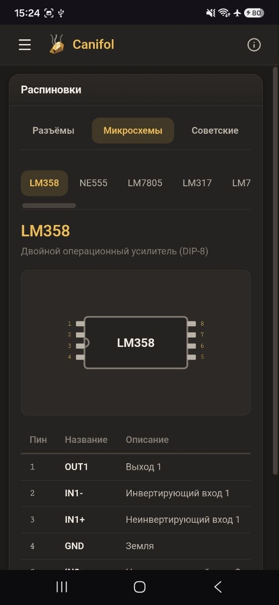
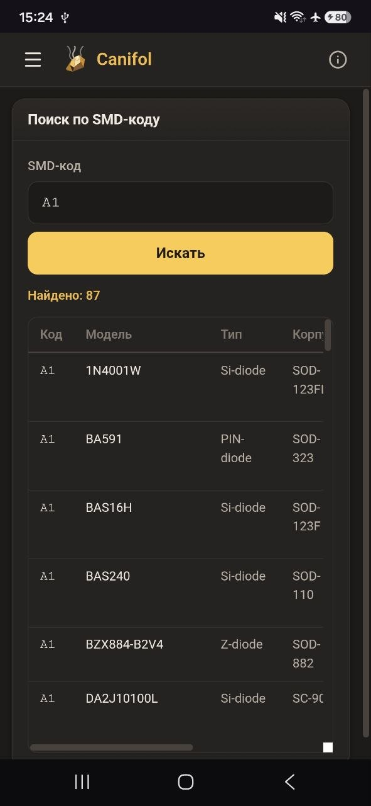
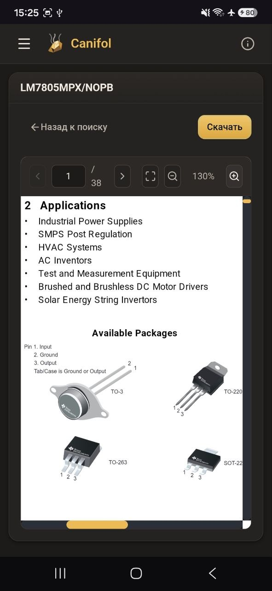

<div align="center">


<h1>Canifol</h1>

<p><strong>Cross-platform electronics repair toolkit — calculators, datasheets, pinouts, SMD database, BoardView, sketch pad, RSS and a 10+ GB Knowledge Base.</strong></p>

<p><em>Кросс-платформенный инструмент ремонтника — калькуляторы, даташиты, распиновки, SMD-база, BoardView, набросок схем, RSS и База знаний на 10+ ГБ.</em></p>

<p><em>跨平台电子维修工具包 — 计算器、数据表、引脚图、SMD 数据库、BoardView、草图板、RSS 和 10+ GB 知识库。</em></p>

<p>
  <a href="https://github.com/invisiblelevel/canifol/releases"></a>
  <a href="LICENSE"></a>
  
  <a href="https://tauri.app/"></a>
  <a href="https://svelte.dev/"></a>
  
</p>

<p>
  <a href="#english">English</a> ·
  <a href="#русский">Русский</a> ·
  <a href="#中文">中文</a> ·
  <a href="https://invisiblelevel.github.io/canifol/">Landing page</a>
</p>

</div>

> ### 📚 **KNOWLEDGE BASE: 6,000+ FILES (10+ GB) OF SCHEMATICS AND BOARDVIEWS FOR LAPTOPS, GPUS AND CONSOLES — RIGHT INSIDE THE APP.**
> ### 💾 **NO NEED TO DOWNLOAD ARCHIVES — EVERYTHING OPENS IN ONE CLICK.**

---

## Screenshots

| Pinouts | SMD code search | Built-in PDF viewer |
| :---: | :---: | :---: |
|  |  |  |
| Microchips, connectors, dev boards | 270,974 components by package code | Datasheets without leaving the app |

---

## English

Canifol is a free toolkit for electronics repair technicians. It combines component calculators, datasheet search, pinouts, an SMD code database, a full-featured **BoardView**, a **sketch pad** for drawing schematics, an **RSS feed** with repair videos, and a **Knowledge Base** — all inside one app. After the first launch it works fully offline.

**Available on Windows, Android and Linux.** The desktop build ships as a standard Windows installer (`.exe`), the mobile build as a standalone Android APK (`.apk`), and the Linux build as `.deb`, `.rpm` and `.AppImage` (auto-built via GitHub Actions). All files are attached to every release.

### What's new in 1.6.2

- **Portable builds fixed** — datasheet API credentials are embedded at compile time from `src-tauri/.env` or CI secrets, so a portable `.exe`/APK can search DigiKey, LCSC, Farnell and TME without a local `.env` file.
- **30 new pinouts** — 10 BIOS/firmware SPI flash chips (W25Q32JV, W25Q64JV, W25Q128JV, W25Q256JV, MX25L6406E, MX25L12835F, GD25Q64C, GD25Q128C, SST25VF016B, EN25Q128), 10 import ICs (MAX7219, DS1307, PCF8591, MAX3232, 74HC165, ACS712, MAX6675, TP4056, NCP1117, LM2576) and 10 Soviet ICs (K155LE1, K155LA1, K155LN1, K555ID7, K555IR1, K555LP5, K555LI1, K155IE6, KR544UD1, K157UD2).
- **Cleaner build scripts** — API keys are no longer hardcoded in the local PowerShell scripts; local builds read `src-tauri/.env`, CI uses repository secrets.

#### Also included from 1.6.1

- **Knowledge Base downloads fixed** — files are no longer saved as a "2 KB corrupt PDF". The app now validates HTTP status and payload type, verifies PDF/JSON integrity, retries Google Drive confirmations, and automatically re-downloads corrupt cached files.
- **Clear download errors** — if Google Drive is blocked or a quota is exceeded, you get the real reason and an **Open in browser** fallback instead of a broken file. System proxy is honored.
- **Better offline database controls** — the selected folder is now used by Settings as well (size and cleanup), and only database files are removed.
- **BoardView parser fixes** — GenCAD units (`UNITS USER/MM/INCH/MIL`) are converted to mm, pads keep their real positions, plain-text FZ is supported, Apple BRD/BRD2 outlines are sanity-checked, TVW parsing is faster and ASCII TVW components get real bounds, XZZ is hardened against malformed files.
- **Datasheet improvements** — offline favorites are found again, PDFs can be saved to any folder (Desktop, Downloads, USB), binary PDF transfer is much faster, LCSC reports real API errors and resolves datasheet URLs in parallel.
- **UI and Sketch fixes** — no more results-list crashes or HTML injection in Knowledge Base highlighting, PDF previews release memory, theme/language stay in sync, EN/ZH pinouts no longer truncate, units (mΩ, mH) are correct, and Sketch gets working Delete, Android taps, drag-undo, storage handling and file saving.
- **Release stability** — 33 Rust unit tests, parser panics no longer abort the app, and BoardView files are size-limited.

### Features

- **Resistors** — SMD code, color codes, Ohm's law, series/parallel, voltage divider, resistor picker.
- **Capacitors** — marking, SMD code, reactance (Xc), connections, ESR check.
- **Inductors** — marking, reactance (Xl), connections, Wheeler geometry.
- **BMS** — balancing resistor, S/P pack, current shunt, MOSFET protection.
- **Transistors** — analog search (DigiKey + LCSC + Soviet database), parametric search, base resistor calculator.
- **Datasheets** — search via **DigiKey, LCSC, Farnell and TME**, download PDFs with local caching, offline favorites, built-in PDF viewer.
- **Pinouts** — connectors, imported ICs, Soviet microchips, and development boards (Arduino Mega 2560, Raspberry Pi Pico, MCP2515, MCP23017, ESP32-CAM, NRF24L01+ and more).
- **SMD Code Search** — database of 270,974 components. Search by the code printed on the package, with prefix lookup.
- **Favorites** — save SMD codes, pinouts, and datasheets. Offline PDF support.
- **BoardView** — open `.fz`, `.cae`, `.cad`, `.bdv`, `.asc`, `.pcb`, `.tvw` and `.brd`, highlight nets, search components, toggle TOP / BOTTOM / Both layers, three color themes (Canifol, OpenBoardView, Light).
- **Sketch pad** — draw schematics with pencil/wire/point/text, stamp components, load a PCB photo as background, pan/zoom/pinch, export to PNG.
- **RSS feed** — YouTube videos (RU/EN) and Bilibili videos (ZH) from repair channels. Native fullscreen on Android, iframe on desktop.
- **Knowledge Base** — 6,000+ schematics and BoardViews (10+ GB) for laptops, GPUs and consoles. Synced from Google Drive with MEGA fallback, smart search (by model, category and file name), built-in PDF and BoardView viewers. Download the whole base for offline use with progress, speed and ETA.
- **Localization** — English, Russian and Chinese, with automatic system language detection.
- **Settings** — interface zoom (70–150%), light/dark theme, unified cache size and cleanup, offline favorites cleanup, RSS cache cleanup, local database size and cleanup.

### Tech stack

Tauri 2 · Svelte 5 (runes) · Rust · Vite · `svelte-pdf-view` · `pcbrepair` · `gencad` · `des` (XZZ) · `encoding_rs` (RSS) · `megalib` (MEGA fallback).

### Install

| Platform | File | How |
| --- | --- | --- |
| **Windows** | `Canifol_1.6.2_x64-setup.exe` | Download from [Releases](https://github.com/invisiblelevel/canifol/releases) and run the installer. |
| **Android** | `Canifol v1.6.2.apk` | Download the APK, allow installation from unknown sources, install. |
| **Linux** | `.deb`, `.rpm`, `.AppImage` | Download from Releases. For AppImage: `chmod +x` and run. |

### Build from source

```bash
git clone https://github.com/invisiblelevel/canifol.git
cd canifol
npm install

npm run tauri dev                              # development
npm run tauri build                            # Windows release
npm run tauri build -- --no-bundle             # release exe only
npm run tauri android build -- --apk           # Android APK
npm run tauri android build -- --apk --debug   # debug APK
```

> **Note:** always produce release binaries with `npm run tauri build`. It enables Tauri's `custom-protocol` feature. A plain `cargo build --release` produces a dev-mode binary that tries to open `http://localhost:1420` and shows a connection error.

> **Datasheet search:** copy `src-tauri/.env.example` to `src-tauri/.env` and fill in your API keys before building. The keys are embedded at compile time, so the portable exe/APK does not need a `.env` file.

---

## Русский

Canifol — бесплатный инструмент для ремонтников электроники. Калькуляторы компонентов, поиск даташитов, распиновки, база SMD-кодов, полноценный **BoardView**, **набросок схем**, **RSS-лента** с видео по ремонту и **База знаний** — всё в одном приложении. После первого запуска работает полностью офлайн.

**Доступно на Windows, Android и Linux.** Десктопная версия поставляется как обычный установщик (`.exe`), мобильная — как отдельный APK (`.apk`), Linux — как `.deb`, `.rpm` и `.AppImage` (автосборка через GitHub Actions). Все файлы прикрепляются к каждому релизу.

### Что нового в 1.6.2

- **Починены портативные сборки** — ключи API даташитов вшиваются при компиляции из `src-tauri/.env` или секретов CI, поэтому портативный `.exe`/APK ищет даташиты на DigiKey, LCSC, Farnell и TME без локального `.env`.
- **30 новых распиновок** — 10 микросхем BIOS/прошивок SPI Flash (W25Q32JV, W25Q64JV, W25Q128JV, W25Q256JV, MX25L6406E, MX25L12835F, GD25Q64C, GD25Q128C, SST25VF016B, EN25Q128), 10 импортных (MAX7219, DS1307, PCF8591, MAX3232, 74HC165, ACS712, MAX6675, TP4056, NCP1117, LM2576) и 10 советских (К155ЛЕ1, К155ЛА1, К155ЛН1, К555ИД7, К555ИР1, К555ЛП5, К555ЛИ1, К155ИЕ6, КР544УД1, К157УД2).
- **Чище сборочные скрипты** — ключи API больше не захардкожены в отслеживаемых PowerShell-скриптах; локальная сборка читает `src-tauri/.env`, CI — секреты репозитория.

#### Также включены исправления 1.6.1

- **Починена загрузка Базы знаний** — файлы больше не сохраняются как «2 КБ битый PDF». Проверяются HTTP-статус и тип ответа, целостность PDF/JSON, обрабатываются подтверждения Google Drive, а битый кэш перекачивается автоматически.
- **Понятные ошибки загрузки** — если Google Drive заблокирован или превышена квота, приложение показывает реальную причину и предлагает **«Открыть в браузере»** вместо повреждённого файла. Системный прокси учитывается.
- **Удобнее офлайн-база** — выбранная папка теперь используется и в Настройках (размер и очистка), удаляются только файлы базы.
- **Исправления парсеров BoardView** — GenCAD переводит единицы (`UNITS USER/MM/INCH/MIL`) в миллиметры, пады получают реальные координаты, поддерживается plain-text FZ, контуры Apple BRD/BRD2 проверяются на адекватность, TVW разбирается быстрее и строит границы ASCII-компонентов, XZZ защищён от битых файлов.
- **Улучшения даташитов** — офлайн-избранное снова находится, PDF сохраняется в любую папку (Рабочий стол, Загрузки, USB), бинарная передача PDF стала быстрее, LCSC показывает реальные ошибки API и параллельно получает ссылки.
- **Интерфейс и Набросок** — устранены падения списка результатов и HTML-инъекция в подсветке Базы, PDF-просмотр освобождает память, тема и язык синхронизированы, распиновки EN/ZH больше не обрезаются, единицы (мОм, мГн) корректны; в Наброске работают Del, тапы на Android, Undo перетаскивания, сохранение файлов и обработка заполненного хранилища.
- **Стабильность релиза** — 33 юнит-теста, паника парсера больше не роняет приложение, файлы BoardView ограничены по размеру.

### Что умеет

- **Резисторы** — SMD-код, цвета, закон Ома, соединения, делитель, подбор.
- **Конденсаторы** — маркировка, SMD, реактивное сопротивление (Xc), соединения, ESR.
- **Катушки** — маркировка, реактивное сопротивление (Xl), соединения, геометрия (Уилер).
- **BMS** — балансир, S/P сборка, шунт, защита на MOSFET.
- **Транзисторы** — поиск аналога (DigiKey + LCSC + советская база), подбор по параметрам, расчёт базового резистора.
- **Даташиты** — поиск через **DigiKey, LCSC, Farnell и TME**, скачивание PDF с локальным кэшем, офлайн-избранное, встроенный просмотрщик.
- **Распиновки** — разъёмы, импортные микросхемы, советские микросхемы и платы разработчика (Arduino Mega 2560, Raspberry Pi Pico, MCP2515, MCP23017, ESP32-CAM, NRF24L01+ и другие).
- **Поиск по SMD-кодам** — база на 270 974 компонента. Поиск по коду на корпусе, включая поиск по префиксу.
- **Избранное** — сохранение SMD-кодов, распиновок и даташитов. Офлайн-доступ к PDF.
- **BoardView** — открытие `.fz`, `.cae`, `.cad`, `.bdv`, `.asc`, `.pcb`, `.tvw` и `.brd`, подсветка цепей, поиск компонентов, слои TOP / BOTTOM / Оба, три цветовые темы (Canifol, OpenBoardView, Light).
- **Набросок** — рисование схем карандашом/проводом/точкой/текстом, штампы компонентов, загрузка фото платы как фона, зум/панорамирование/пинч, экспорт в PNG.
- **RSS-лента** — видео с YouTube (RU/EN) и Bilibili (ZH) каналов по ремонту. Нативный фуллскрин на Android, iframe на десктопе.
- **База знаний** — 6 000+ схем и BoardView (10+ ГБ) для ноутбуков, видеокарт и консолей. Синхронизируется с Google Drive (фоллбэк на MEGA), умный поиск (по модели, категории и имени файла), встроенный просмотр PDF и BoardView. Скачивание всей базы офлайн с прогрессом, скоростью и ETA.
- **Локализация** — русский, английский, китайский. Автоопределение языка системы.
- **Настройки** — масштаб интерфейса (70–150%), светлая/тёмная тема, размер единого кэша и его очистка, очистка офлайн-избранного, очистка кэша RSS, размер и очистка локальной базы.

### Стек

Tauri 2 · Svelte 5 (руны) · Rust · Vite · `svelte-pdf-view` · `pcbrepair` · `gencad` · `des` (XZZ) · `encoding_rs` (RSS) · `megalib` (фоллбэк на MEGA).

### Установка

| Платформа | Файл | Как установить |
| --- | --- | --- |
| **Windows** | `Canifol_1.6.2_x64-setup.exe` | Скачать из [Releases](https://github.com/invisiblelevel/canifol/releases) и запустить установщик. |
| **Android** | `Canifol v1.6.2.apk` | Скачать APK, разрешить установку из неизвестных источников, установить. |
| **Linux** | `.deb`, `.rpm`, `.AppImage` | Скачать из Releases. Для AppImage: `chmod +x` и запустить. |

### Сборка из исходников

```bash
git clone https://github.com/invisiblelevel/canifol.git
cd canifol
npm install

npm run tauri dev                              # разработка
npm run tauri build                            # релиз (Windows)
npm run tauri build -- --no-bundle             # только exe
npm run tauri android build -- --apk           # релиз (Android APK)
npm run tauri android build -- --apk --debug   # debug APK
```

> **Важно:** релизные бинарники собирай только через `npm run tauri build` — эта команда включает фичу Tauri `custom-protocol`. Обычный `cargo build --release` даёт dev-сборку, которая пытается открыть `http://localhost:1420` и показывает ошибку соединения.

> **Поиск даташитов:** скопируй `src-tauri/.env.example` в `src-tauri/.env` и заполни ключи API перед сборкой. Ключи вшиваются при компиляции, поэтому портативному exe/APK файл `.env` не нужен.

---

## 中文

Canifol 是一款免费的电子维修技术人员工具。内置元器件计算器、数据表搜索、引脚图、SMD 代码数据库、功能齐全的 **BoardView**、**草图板**（绘制原理图）、**RSS 订阅**（维修视频）以及 **知识库**。首次启动后完全支持离线使用。

**支持 Windows、Android 和 Linux。** 桌面版为标准 Windows 安装程序 (`.exe`)，移动版为独立的 Android APK (`.apk`)，Linux 版为 `.deb`、`.rpm` 和 `.AppImage`（通过 GitHub Actions 自动构建）。所有文件均附在每次发布中。

### 1.6.2 新功能与修复

- **修复便携版** — 数据表 API 密钥在编译时从 `src-tauri/.env` 或 CI Secrets 嵌入，便携版 `.exe`/APK 无需本地 `.env` 即可搜索 DigiKey、LCSC、Farnell 和 TME。
- **新增 30 个引脚图** — 10 个 BIOS/固件 SPI 闪存（W25Q32JV、W25Q64JV、W25Q128JV、W25Q256JV、MX25L6406E、MX25L12835F、GD25Q64C、GD25Q128C、SST25VF016B、EN25Q128）、10 个进口芯片（MAX7219、DS1307、PCF8591、MAX3232、74HC165、ACS712、MAX6675、TP4056、NCP1117、LM2576）和 10 个苏联芯片（K155LE1、K155LA1、K155LN1、K555ID7、K555IR1、K555LP5、K555LI1、K155IE6、KR544UD1、K157UD2）。
- **构建脚本更干净** — API 密钥不再硬编码在受版本控制的 PowerShell 脚本中；本地构建读取 `src-tauri/.env`，CI 使用仓库 Secrets。

#### 同时包含 1.6.1 修复

- **修复知识库下载** — 文件不再被保存成“2 KB 的损坏 PDF”。现在会校验 HTTP 状态和响应类型、检查 PDF/JSON 完整性、处理 Google Drive 确认流程，并自动重新下载损坏的缓存。
- **明确的下载错误** — 如果 Google Drive 被屏蔽或超出配额，会显示真实原因并提供 **在浏览器中打开**，而不是损坏文件。支持系统代理。
- **离线数据库更完善** — 设置中的大小统计和清理也会使用所选文件夹，并且只删除数据库文件。
- **BoardView 解析器修复** — GenCAD 的 `UNITS USER/MM/INCH/MIL` 会转换为毫米，焊盘保留真实坐标，支持纯文本 FZ，Apple BRD/BRD2 轮廓会做合理性检查，TVW 解析更快且 ASCII 组件有真实边界，XZZ 对损坏文件更安全。
- **数据表改进** — 离线收藏恢复正常，PDF 可保存到任意文件夹（桌面、下载、U 盘），二进制传输更快，LCSC 显示真实 API 错误并并行获取数据表链接。
- **界面与草图板** — 修复结果列表崩溃和知识库高亮中的 HTML 注入，PDF 预览会释放内存，主题/语言保持同步，EN/ZH 引脚图不再被截断，单位（mΩ、mH）正确；草图板的 Delete、Android 触摸、拖动撤销、文件保存和存储已满处理均已修复。
- **发布稳定性** — 33 个 Rust 单元测试，解析器 panic 不再导致应用退出，BoardView 文件有大小限制。

### 功能

- **电阻器** — SMD 代码、色环、欧姆定律、串并联、分压器、电阻选择。
- **电容器** — 标识、SMD 代码、电抗 (Xc)、连接、ESR 检查。
- **电感器** — 标识、电抗 (Xl)、连接、Wheeler 几何。
- **BMS** — 均衡电阻、串/并联电池组、电流分流器、MOSFET 保护。
- **晶体管** — 模拟搜索（DigiKey + LCSC + 苏联数据库）、参数搜索、基极电阻计算器。
- **数据表** — 通过 **DigiKey、LCSC、Farnell 和 TME** 搜索，下载 PDF 并本地缓存，离线收藏，内置 PDF 查看器。
- **引脚图** — 连接器、进口 IC、苏联微芯片和开发板（Arduino Mega 2560、Raspberry Pi Pico、MCP2515、MCP23017、ESP32-CAM、NRF24L01+ 等）。
- **SMD 代码搜索** — 270,974 个元器件数据库。按封装上印刷的代码搜索，支持前缀查找。
- **收藏夹** — 保存 SMD 代码、引脚图和数据表。支持离线 PDF。
- **BoardView** — 打开 `.fz`、`.cae`、`.cad`、`.bdv`、`.asc`、`.pcb`、`.tvw` 和 `.brd` 文件，高亮网络，搜索元器件，切换 TOP / BOTTOM / 两者图层，三种配色主题（Canifol、OpenBoardView、Light）。
- **草图板** — 用铅笔/导线/点/文本绘制原理图，图章组件，加载 PCB 照片作为背景，缩放/平移/双指缩放，导出为 PNG。
- **RSS 订阅** — 来自 YouTube（俄语/英语）和 Bilibili（中文）维修频道的视频。Android 上原生全屏，桌面端使用 iframe。
- **知识库** — 6000+ 个原理图和 BoardView（10+ GB），适用于笔记本电脑、显卡和游戏机。从 Google Drive 同步（带 MEGA 备用源），智能搜索（按型号、类别和文件名），内置查看 PDF 和 BoardView 文件。可离线下载整个数据库，显示进度、速度和预计剩余时间。
- **本地化** — 英语、俄语和中文，自动检测系统语言。
- **设置** — 界面缩放 (70–150%)、浅色/深色主题、统一缓存大小和清理、离线收藏夹清理、RSS 缓存清理、本地数据库大小和清理。

### 技术栈

Tauri 2 · Svelte 5 (runes) · Rust · Vite · `svelte-pdf-view` · `pcbrepair` · `gencad` · `des`（XZZ）· `encoding_rs`（RSS）· `megalib`（MEGA 备用源）。

### 安装

| 平台 | 文件 | 安装方法 |
| --- | --- | --- |
| **Windows** | `Canifol_1.6.2_x64-setup.exe` | 从 [Releases](https://github.com/invisiblelevel/canifol/releases) 下载并运行安装程序。 |
| **Android** | `Canifol v1.6.2.apk` | 下载 APK，允许从未知来源安装，然后安装。 |
| **Linux** | `.deb`、`.rpm`、`.AppImage` | 从 Releases 下载。AppImage 需 `chmod +x` 后运行。 |

### 从源码构建

```bash
git clone https://github.com/invisiblelevel/canifol.git
cd canifol
npm install

npm run tauri dev                              # 开发模式
npm run tauri build                            # 发布 (Windows)
npm run tauri build -- --no-bundle             # 仅 exe
npm run tauri android build -- --apk           # 发布 (Android APK)
npm run tauri android build -- --apk --debug   # 调试 APK
```

> **重要：** 发布版本必须使用 `npm run tauri build` 构建，它会启用 Tauri 的 `custom-protocol` 功能。直接运行 `cargo build --release` 会得到开发版，尝试打开 `http://localhost:1420` 并显示连接错误。

> **数据表搜索：** 构建前请将 `src-tauri/.env.example` 复制为 `src-tauri/.env` 并填写 API 密钥。密钥会在编译时嵌入，因此便携版 exe/APK 不需要 `.env` 文件。

---

## License

MIT — see [LICENSE](LICENSE).

## Author

INV.LVL · [@invisiblelevel](https://github.com/invisiblelevel)

<div align="center">
<sub>Built with Rust, Tauri 2 and Svelte 5. Datasheets from DigiKey, LCSC, Farnell and TME. Knowledge Base powered by Google Drive with MEGA fallback.</sub>
</div>
